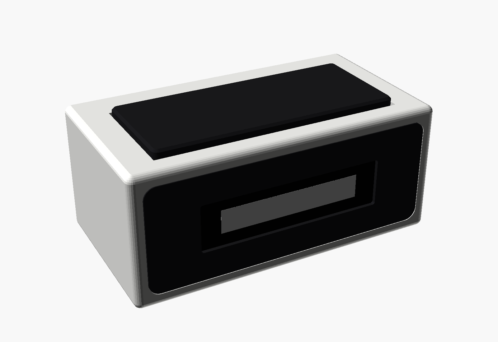
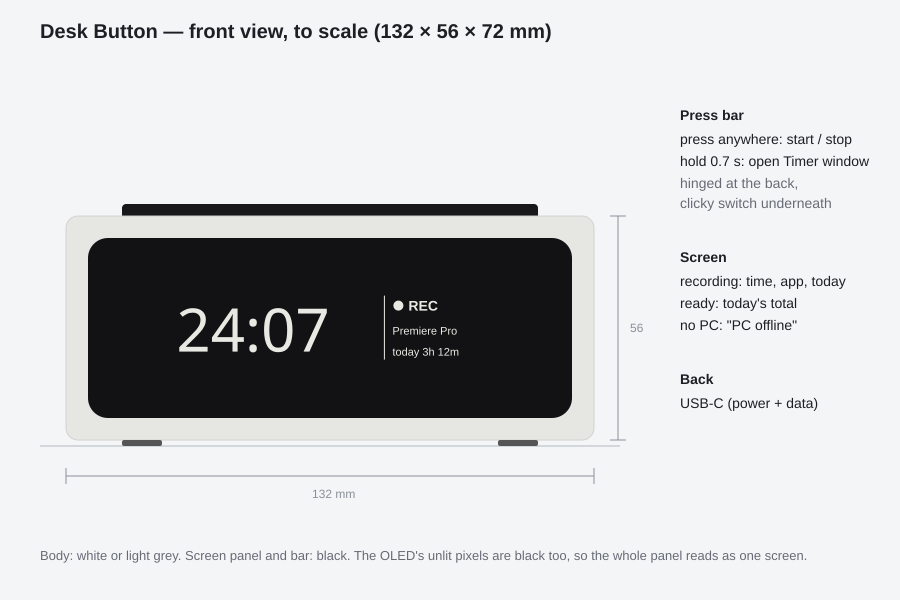

# Desk Button for Simple Timer

A clean little block for your desk: a wide screen on the front and one long press bar across the top. Press the bar anywhere to start or stop the Timer. The screen shows how long you've been going, which app you're in, and today's total.



| Front view (to scale) | Printed parts, laid out for printing |
|---|---|
|  |  |

Ready-to-print STL files are in [`stl/`](stl/).

- **Press** the bar to start or stop the Timer. **Hold for 0.7 s** to open the Timer window.
- **While recording**, the screen shows a big running clock, a blinking REC dot, the current app and today's total.
- **When ready**, it shows today's total and dims after 10 minutes of no use.
- **If the PC side isn't running**, it says *PC offline*.

## How it fits together

```
 ┌──────── desk button ────────┐   USB-C cable    ┌──────────────── PC ─────────────────────┐
 │ press bar ─► ESP32-C3       │  (power + data)  │ bridge.py (runs hidden at login)        │
 │                 │           │ ◄──────────────► │   "TOGGLE" ─► Local\SimpleTimerToggle ─►│─► Timer app
 │                 └─► OLED    │  text lines      │   "SHOW"   ─► Local\SimpleTimerShow   ─►│
 └─────────────────────────────┘                  │   every 1 s ◄─ reads timer.db (read-only)│
                                                  └─────────────────────────────────────────┘
```

**Why USB serial and not a keyboard shortcut:** the button could pretend to be a keyboard and press Ctrl+Alt+T, but another app on this PC already uses that shortcut. A keyboard also can't receive anything back, so the screen would never know the time. Over a serial link, the button says "TOGGLE" and the PC sends back the state every second. It needs no driver, and the Timer app itself isn't changed at all.

**How the bridge toggles the timer:** it sets the Windows event `Local\SimpleTimerToggle`, which is the same thing the desktop shortcut does, but without starting a new process each time. If the Timer isn't running, the bridge launches `simple-timer\.venv\Scripts\pythonw.exe timer.py --toggle` instead, which starts the app already recording.

**Where the state comes from:** the bridge opens the Timer's SQLite database **read-only**. The Timer runs on Microsoft Store Python, so its `%APPDATA%\SimpleTimer\timer.db` really lives at
`%LOCALAPPDATA%\Packages\PythonSoftwareFoundation.Python.3.12_…\LocalCache\Roaming\SimpleTimer\timer.db`.
The bridge checks both places and uses the newer file. This was tested on this PC: both regular Python 3.9 and the Store Python 3.12 read the live session correctly. A leftover unfinished session with no Timer process running counts as "not running".

## Files

| File | What it is |
|------|------------|
| `enclosure.scad` | Parametric 3D model (OpenSCAD); one file holds all the printed parts |
| `stl/`, `preview/` | Exported STL files and pictures |
| `export-stl.ps1` | Re-exports the STL files and pictures after you change a measurement (needs OpenSCAD) |
| `concept.svg` | To-scale front view |
| `wiring.svg` | Wiring diagram (also in text below) |
| `BOM.md` | Parts list with prices and where to buy |
| `firmware\` | PlatformIO project for the ESP32-C3 SuperMini |
| `bridge.py` | The PC side; `python bridge.py --status` shows what it would send |
| `setup.ps1` | One-time PC setup: Python environment, Startup shortcut, starts the bridge |

## 1. Order parts

See [BOM.md](BOM.md). It's about ₹2,600–3,800 from Indian shops, and the 3.12" OLED is most of that.

**When the parts arrive, measure them** before printing. If they differ, change the numbers at the top of `enclosure.scad` and run `export-stl.ps1`:
- `glass_w` × `glass_h`: the OLED glass, assumed 88 × 27.8 mm.
- `oled_pcb_w` × `oled_pcb_h`: the OLED board, assumed 100.5 × 33.5 mm.
- `choc_above_plate`: how far the switch stem sticks up above the plate it clips into, assumed 5.0 mm.

## 2. Print (for your friend)

Slice the files in `stl/` as they are; they're already the right way up.

| Part | Colour / material | Orientation | Notes |
|------|----------|-------------|-------|
| `shell` | **white or light grey** PLA/PETG | **front face down** | ≈5–6 h. A smooth or textured PEI sheet gives the front a great finish. |
| `bezel` | **black** | flat | the screen panel, ≈20 min |
| `bar` | **black** | top face down | ≈1 h |
| `back` | same as the shell | outside face down | ≈1 h |
| `clamp` | anything | flat | **print 2** |

Settings: 0.2 mm layers, 3 walls, 15–20 % gyroid infill, **no supports needed**, no brim. Walls are 2.4 mm and fit clearances 0.25 mm. If the back cover is too tight, set `clr = 0.3` and re-export.

## 3. Wire it

Full diagram: [wiring.svg](wiring.svg). It's only 9 wires. Solder them straight to the pads, about 10–12 cm long.

```
ESP32-C3 SuperMini           Device
------------------           ------------------------------------------
3V3     ───────────────────  OLED VCC
GND     ───────────────────  OLED GND, and one switch pin
GPIO 4  ───────────────────  OLED SCL  (a.k.a. CLK / D0)
GPIO 6  ───────────────────  OLED SDA  (a.k.a. DIN / D1)
GPIO 10 ───────────────────  OLED DC
GPIO 7  ───────────────────  OLED CS
GPIO 3  ───────────────────  OLED RES  (a.k.a. RST)
GPIO 5  ───────────────────  the other switch pin
```

The OLED must be set to **4-wire SPI**. Most are sold that way, and the seller's page shows which resistors set it.

## 4. Flash the firmware

1. Install **VS Code** (already on this PC) and the **PlatformIO IDE** extension.
2. **File → Open Folder** → `desk-button\firmware`, plug in the board, and click the **→ Upload** arrow in the bottom bar.
3. If uploading fails, hold the board's **BOOT** button, tap **RST**, release BOOT, and upload again.

**Test it on the desk before closing the case.** The screen should say *Waiting for PC*.

## 5. PC setup (once)

In PowerShell, inside `desk-button\`:

```powershell
powershell -ExecutionPolicy Bypass -File setup.ps1
```

This creates `desk-button\.venv` with `pyserial`, adds a hidden **Desk Button Bridge** shortcut to your Startup folder, and starts the bridge. Within a few seconds the screen shows *READY* and today's total. Press the switch and the Timer starts.

To check what the bridge sees at any time, with no hardware needed:

```powershell
.venv\Scripts\python.exe bridge.py --status
```

Its log is `desk-button\bridge.log`.

## 6. Assemble

1. **Screen panel:** press the black **bezel** into the recess on the front. It's a snug fit; add a few dots of glue if it's loose.
2. **OLED:** from inside, push the OLED's glass into the rectangular opening behind the bezel, with its pins toward the side nearest the board. Press it home with the two **clamps** (pads toward the OLED) and 4 × M2 screws. Snug is enough; don't crush the glass.
3. **Switch:** clip the Choc switch **up** into the square hole in the little shelf under the top. Solder its two wires.
4. **Bar:** drop the **bar** into the top slot. Its two ears go down beside the hinge posts. From inside, put an M3 × 10 screw through each ear into its post, tight enough to hold but loose enough that the bar swings freely. The switch's spring holds the bar up against the ledge at the back of the slot.
5. **Board:** lay the SuperMini on the shelf of the **back** cover, USB-C into the opening. The fin over the connector holds it down, and the lip at the front stops it moving when you plug in the cable.
6. A dab of hot glue on the wire bundles keeps them from flexing. Close the back with **4 × M3 countersunk** screws, and stick the 4 rubber feet into their recesses underneath.

## Rough cost and time

- **Cost:** about ₹2,600–3,800 in parts, plus about 140 g of filament.
- **Printing:** about 8 h, unattended.
- **Soldering and assembly:** about 1.5 h.
- **Software setup:** about 30 min.

## Status: what's tested and what isn't

- ✅ `enclosure.scad` renders in OpenSCAD 2021.01, and all five parts export as clean, watertight STL files.
- ✅ `bridge.py`'s database reading and Timer detection were tested against the live Timer on this PC, with both Pythons. Both Windows events exist. Toggling wasn't fired, so your tracking wasn't disturbed.
- ⚠️ The firmware is **not compiled yet** (PlatformIO isn't installed here). It uses the standard U8g2 display library. Expect at most a small fix on the first build.
- ⚠️ The hinge feel, the switch preload and the serial link all need the real parts to check. If the bar rattles, increase `choc_above_plate` by 0.3 mm. If it won't rest on the ledge, decrease it.

## Proposed follow-up for `timer.py` (not done, because another session is editing it)

The bridge works without changing the Timer, but two small additions would make the link instant and sturdier:

1. **A "state changed" event.** After every start or stop, `timer.py` would `SetEvent` a new auto-reset event, `Local\SimpleTimerChanged`. The bridge would wait on it and update the screen immediately instead of up to 1 s later.
2. **A tiny `status.json`**, such as `{"running": true, "start": "...", "app": "...", "today_s": 1234}`, written next to `timer.db` on each tick. The bridge would read that instead of the database, so later changes to `timer.py`'s tables can't break the button.

Neither is needed for the button to work.

## Stretch ideas

- **Cordless:** add a LiPo battery with a TP4056 charger, and switch the firmware to Bluetooth LE. The bridge would then use the `bleak` package instead of serial. The ESP32-C3 already has the radio, and there's room behind the switch shelf for a flat 1000 mAh cell.
- **Haptic thunk:** a coin vibration motor under the bar, on a spare pin, pulsed for 40 ms per press.
- **Week view:** a double-press could flip the screen between *today* and *this week*.
- **Long press:** this already opens the Timer window.
