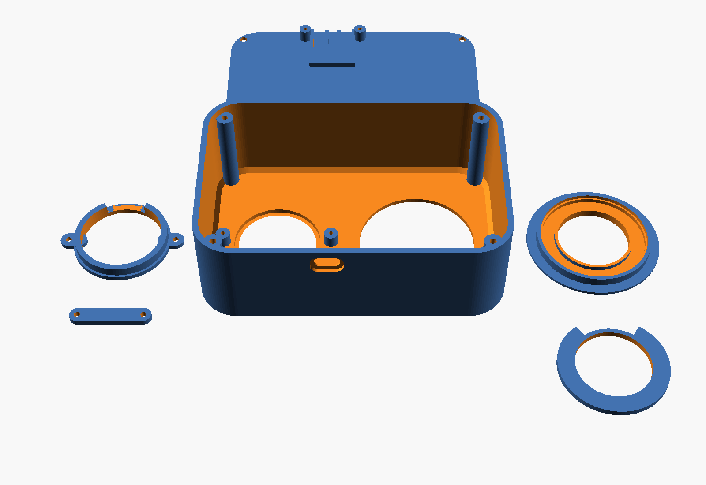

# Desk Button for Simple Timer

A chunky little desk block with a big arcade button and a glowing ring. Tap it to start or stop the Timer. A small round screen shows how long you've been going, which app you're in, and today's total.


| Concept (to scale) | Printed parts, laid out for printing |
|---|---|
|  |  |

Ready-to-print STL files are in [`stl/`](stl/).

- **Ring red** while recording, **dim green** when ready, **amber** if the PC side isn't running. It flashes white when it registers a press.
- **Tap** the button to start or stop the timer. **Hold for 0.7 s** to open the Timer window.

## How it fits together

```
 ┌──────── desk button ────────┐   USB-C cable    ┌──────────────── PC ─────────────────────┐
 │ button ─► ESP32-C3 ─► ring  │  (power + data)  │ bridge.py (runs hidden at login)        │
 │              │              │ ◄──────────────► │   "TOGGLE" ─► Local\SimpleTimerToggle ─►│─► Timer app
 │              └─► display    │  text lines      │   "SHOW"   ─► Local\SimpleTimerShow   ─►│
 └─────────────────────────────┘                  │   every 1 s ◄─ reads timer.db (read-only)│
                                                  └─────────────────────────────────────────┘
```

**Why USB serial and not a keyboard shortcut:** the button could pretend to be a keyboard and press Ctrl+Alt+T, but another app on this PC already uses that shortcut. A keyboard also can't receive anything back, so the screen would never know the time. Over a serial link the button says "TOGGLE" and the PC sends back the state every second. It needs no driver, and the Timer app itself isn't changed at all.

**How the bridge toggles the timer:** it sets the Windows event `Local\SimpleTimerToggle`, which is the same thing the desktop shortcut does, but without starting a new process each time. If the Timer isn't running, it launches `simple-timer\.venv\Scripts\pythonw.exe timer.py --toggle` instead, which starts the app already recording.

**Where the state comes from:** the bridge opens the Timer's SQLite database **read-only**. The Timer runs on Microsoft Store Python, so its `%APPDATA%\SimpleTimer\timer.db` really lives at
`%LOCALAPPDATA%\Packages\PythonSoftwareFoundation.Python.3.12_…\LocalCache\Roaming\SimpleTimer\timer.db`.
The bridge checks both places and uses the newer file. This was tested on this PC: both regular Python 3.9 and the Store Python 3.12 read the live session correctly. A leftover unfinished session, with no Timer process running, counts as "not running".

## Files

| File | What it is |
|------|------------|
| `enclosure.scad` | Parametric 3D model (OpenSCAD). One file holds all six printed parts. |
| `export-stl.ps1` | Exports every part to `stl\` and preview pictures to `preview\` (needs OpenSCAD). |
| `concept.svg` | To-scale drawing of how it looks. |
| `wiring.svg` | Wiring diagram (also in text below). |
| `BOM.md` | Parts list with prices and where to buy. |
| `firmware\` | PlatformIO project for the ESP32-C3 SuperMini. |
| `bridge.py` | The PC side. `python bridge.py --status` shows what it would send. |
| `setup.ps1` | One-time PC setup: Python environment, Startup shortcut, starts the bridge. |

## 1. Order parts

See [BOM.md](BOM.md). That's about ₹1,400–1,900 from Robu.in or Amazon.in. Order **two arcade buttons**, because they're cheap and the feel varies.

**When the parts arrive, measure them** with calipers (or a ruler) before printing, and adjust the numbers at the top of `enclosure.scad` if they differ:
`disp_glass_d` (display glass diameter, ≈35.8), `disp_pcb_d` (display board, ≈39), `ring_od`/`ring_id` (LED ring, 44.5/31.75), `btn_hole` (button thread, fits 30.2).

## 2. Print (for your friend)

The STL files in `stl/` are ready to slice. To change sizes: install OpenSCAD (`winget install OpenSCAD.OpenSCAD`, or openscad.org), edit the numbers, then either run `export-stl.ps1`, or open `enclosure.scad`, choose a `part` in **Window → Customizer**, press **F6** (render), then **F7** (export STL). Single parts come out already in the right print orientation, and `print_all` shows the full plate layout.

| Part | Material | Orientation | Notes |
|------|----------|-------------|-------|
| shell | PLA or PETG, dark/matte | **top face down** (as exported) | ≈4–5 h. A textured PEI sheet gives the top a lovely finish. |
| plate | same | flat, as exported | ≈1.5 h |
| halo | **white or natural (translucent) PETG**, or white PLA | lip down (as exported) | 100 % infill for an even glow |
| spacer, retainer, strap | anything | as exported | ≈30 min together |

Settings: 0.2 mm layers, 3 walls, 15–20 % gyroid infill, **no supports needed**, no brim. Walls are 2.4 mm, top 3 mm, and fit clearances 0.25 mm. If the plate is too tight, set `clr = 0.3`.

## 3. Wire it

Full diagram: [wiring.svg](wiring.svg). Solder wires straight to the pads, without header pins. Wires about 10–12 cm long are plenty.

```
ESP32-C3 SuperMini           Device
------------------           ------------------------------------------
3V3  ──────────────────────  Display VCC
GND  ──────────────────────  Display GND, LED ring GND, Button COM
GPIO 4  ───────────────────  Display SCL  (a.k.a. SCK / CLK)
GPIO 6  ───────────────────  Display SDA  (a.k.a. MOSI / DIN)
GPIO 10 ───────────────────  Display DC
GPIO 7  ───────────────────  Display CS
GPIO 3  ───────────────────  Display RST
GPIO 1  ───────────────────  Display BL   (only if your display has it)
5V   ──────────────────────  LED ring 5V / VCC (the "IN" side)
GPIO 0  ──[ 330 Ω ]────────  LED ring DI / DIN (not DO)
GPIO 5  ───────────────────  Button NO (normally open)
```

If the ring flickers or shows wrong colours, move its power wire from **5V** to **3V3**. It'll be slightly dimmer, but rock-solid.

## 4. Flash the firmware

1. Install **VS Code** (already on this PC) and the **PlatformIO IDE** extension.
2. **File → Open Folder** → `desk-button\firmware`, plug in the board, and click the **→ Upload** arrow in the bottom bar.
3. If uploading fails: hold the board's **BOOT** button, tap **RST**, release BOOT, and upload again.

**Test it on the desk before closing the case.** The screen should say *WAITING* and the ring should breathe amber.

## 5. PC setup (once)

In PowerShell, inside `desk-button\`:

```powershell
powershell -ExecutionPolicy Bypass -File setup.ps1
```

This creates `desk-button\.venv` with `pyserial`, adds a hidden **Desk Button Bridge** shortcut to your Startup folder, and starts it. Within a few seconds the ring turns dim green and the screen shows *READY*. Press the button: the Timer starts, and the ring goes red.

Check what the bridge sees at any time, with no hardware needed:

```powershell
.venv\Scripts\python.exe bridge.py --status
```

Its log is `desk-button\bridge.log`.

## 6. Assemble

1. **Light ring:** drop the **halo** into the big round hole in the top from outside, so its lip sits flush. From inside, press the **LED ring** into the pocket under the halo, LEDs facing up and solder pads toward the back. Lay the **spacer** on it with its notch over the pads.
2. **Button:** push the arcade button down through the halo, ring and spacer from the top, and screw the nut on from inside, firmly but not crazily. Put the microswitch on and connect its **NO** and **COM** wires.
3. **Display:** place it glass-down into its pocket with the pins toward the back. Put the **retainer** over it, with its gap toward the back, and fix it with 2 × M2 screws. Snug is enough; don't crush the glass.
4. **Board:** slide the SuperMini into the cradle on the bottom plate, USB-C toward the back edge. Lay the **strap** across the USB connector and fix it with 2 × M2 screws.
5. A dab of hot glue on wire bundles keeps them from flexing. Close the case with **4 × M3 countersunk** screws, then stick the 4 rubber feet into their recesses.

## Rough cost and time

- **Cost:** about ₹1,400–1,900 in parts, plus about 100 g of filament.
- **Print:** about 7 h, unattended.
- **Soldering and assembly:** 1.5–2 h.
- **Software setup:** about 30 min.

A relaxed weekend, in short.

## Status: what's tested and what isn't

- ✅ `bridge.py`: reading the database and checking whether the Timer is running were tested against the live Timer on this PC, with both Pythons. Both Windows events exist. Toggling wasn't fired, so that tracking wasn't disturbed.
- ✅ `enclosure.scad`: renders in OpenSCAD 2021.01, and all six parts export as clean, watertight STL files (`stl/`). Re-run `export-stl.ps1` after changing any measurements.
- ⚠️ Firmware: **not compiled yet**, because PlatformIO isn't installed here. It uses common libraries, with versions pinned in `platformio.ini`. Expect at most a small fix on the first build.
- ⚠️ The serial handshake and button flow need the real hardware to test.

## Proposed follow-up for `timer.py` (not done: another session is editing it)

The bridge works without changing the Timer, but two small additions would make the link instant and sturdier:

1. **A "state changed" event.** After every start or stop, `timer.py` would call `SetEvent` on a new auto-reset event `Local\SimpleTimerChanged`. The bridge would wait on it and update the screen immediately, instead of up to 1 s later.
2. **A tiny `status.json`** (`{"running": true, "start": "...", "app": "...", "today_s": 1234}`), written next to `timer.db` on each tick. The bridge would then read that instead of the database, so later schema changes in `timer.py` can't break the button.

Neither is needed for the button to work.

## Stretch ideas

- **Cordless:** add a LiPo with a TP4056 charger and switch the firmware to Bluetooth LE. The bridge would talk BLE through the `bleak` package instead of serial. The ESP32-C3 already has the radio, and the case has room under the display for a 500 mAh cell, though `H` may need to grow to about 48.
- **Haptic click:** add a coin vibration motor under the button, driven by a small transistor from a spare pin (GPIO 20). Pulse it for 40 ms on each press.
- **Today's total:** already on the screen, under the app name. A long-press menu could also cycle the screen through *today / this week*.
- **Long-press:** already opens the Timer window. Another option is a double-tap to add a note, by sending `NOTE` and having the bridge open the Timer's note box once `timer.py` offers an event for it.
